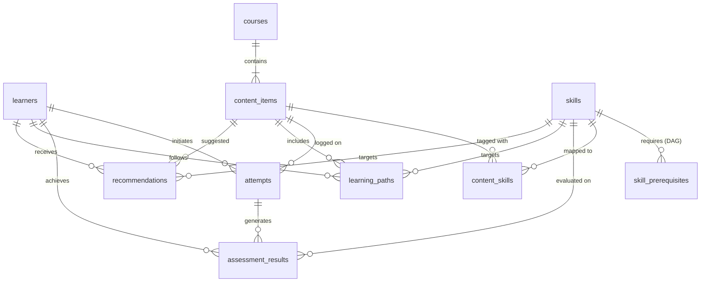

# YottaFlex AI Recruiter Challenge
## Synthetic Learning Data and Explainable Learning Recommendation Workflow

[](https://www.python.org/)
[](https://www.sqlite.org/)
[](tests/)
[](scripts/reproducibility_check.py)
[](LICENSE)

---

## 1. Project Overview

**YottaFlex AI Learning Recommendation Engine** is an end-to-end, local-first platform that calculates temporal-safe learner skill mastery, strictly enforces prerequisite gates, and delivers explainable activity recommendations with transparent reason codes.

Key capabilities:
1. **Deterministic Telemetry Generation**: Generates 10 relational entities from small development cohorts up to **500,000 attempts** using fixed seed `20261022` with 100% SHA-256 reproducibility.
2. **Temporal-Safe EWMA Mastery**: Updates skill competencies using Exponentially Weighted Moving Average (35% recent attempt, 65% prior history) strictly respecting query cutoffs to eliminate future data leakage.
3. **Hard Prerequisite DAG Gating**: Blocks activities requiring unmastered prerequisites (&lt; 0.70) on the backend before ranking.
4. **Explainable Multi-Factor Ranking**: Ranks eligible candidate activities ($0.45 \cdot \text{SkillGap} + 0.35 \cdot \text{DifficultyFit} + 0.20 \cdot \text{Relevance}$) with machine-readable reason codes and human-readable explanations.
5. **Quality Assurance & Anomaly Lab**: Validates clean baseline relational integrity (6/6 checks passed) and detects 5 isolated edge-case anomaly fixtures.
6. **Interactive Single-Page Web App**: Full-stack application featuring a guided recommendation workflow, real-time telemetry simulator, database table explorer, and interactive prerequisite DAG.

---

## 2. Quickstart & Verification (Windows PowerShell)

The solution runs local-first with $0 spend, no paid APIs, and no external cloud secrets.

### 2.1 Prerequisites
- Windows 10/11 with PowerShell
- Python 3.11+ (Python 3.14+ fully verified)

### 2.2 Setup Environment
```powershell
# Verify Python version
py --version

# Install dependencies (FastAPI, uvicorn, pydantic, pytest)
py -m pip install -r requirements.txt
```

### 2.3 Run Automated Verification Suite (34 Tests)
```powershell
# 1. Validate baseline database integrity and 5 isolated anomaly fixtures
py scripts/validate_data.py

# 2. Verify deterministic reproducibility (10/10 table SHA-256 match)
py scripts/reproducibility_check.py

# 3. Run complete automated test suite (34 tests)
py -m pytest -v
```

### 2.4 Launch the Production Web Application
Start the full-stack web application with a single command:
```powershell
py run_server.py
```
- **Web Application UI:** [http://localhost:8000](http://localhost:8000) (Calm, accessible light theme with guided recommendation workflow)
- **Interactive REST API Documentation:** [http://localhost:8000/docs](http://localhost:8000/docs)
- **OpenAPI JSON Spec:** [http://localhost:8000/openapi.json](http://localhost:8000/openapi.json)

---

## 2.5 Step-by-Step Evaluator Walkthrough Guide

Follow this 5-step path to test the application end-to-end:

1. **Step 1: Open the Application & Home Overview (Panel 1)**
   - Navigate to `http://localhost:8000`.
   - Read the one-sentence summary, review the 4 live metric boxes (50 Learners, 5 Courses, 20 Skills, 600 Attempts), and click **"Start a Recommendation →"**.

2. **Step 2: Learner Mastery & Temporal Cutoffs (Panel 2)**
   - Click **"Learner Mastery"** on the left sidebar.
   - Filter or select **`LRN-000001 (Alice Chen)`** from the searchable dropdown.
   - Inspect her profile card (Overall Mastery: 72%, Total Assessments: 12).
   - Review her **Skill Mastery Breakdown** (progress bars with status pills) and **Recent Assessment History** table side-by-side.
   - Test temporal safety: Switch the **"Time Cutoff"** dropdown to **"Last 7 Days (2026-10-15)"** or **"Last 30 Days"**. Notice scores adjust dynamically without future attempt leakage.

3. **Step 3: Generate Recommendations & Inspect Prerequisite Gates (Panel 3)**
   - Click **"Recommendations"** on the left sidebar.
   - Click **"Generate Recommendations"**.
   - Review the **Top Recommendation banner** and summary stat boxes (Recommended, Blocked by Prerequisite, Total Evaluated).
   - In the **Recommended Learning Activities** table, inspect ranked activities with difficulty, skills, score, and why recommended.
   - Observe **Blocked Activities** (e.g. `🔒 Gated Content` requiring unmastered prerequisites like Python/SQL with specific current vs required mastery scores).

4. **Step 4: Real-Time Learning Simulator (Panel 4)**
   - Click **"Real-time Simulator"** on the left sidebar.
   - Select a content item, review its skill tag and difficulty, enter score `85` and duration `18` mins, and click **"Submit Attempt"**.
   - Notice the atomic database insertion confirmation. Return to **"Learner Mastery"** or **"Recommendations"** to observe Alice's live score and rankings update immediately.

5. **Step 5: Quality & Anomaly Lab, Explorer & Metrics (Panels 5, 6, 7 & 8)**
   - Click **"Quality & Anomaly Lab"**: Observe that the **Clean Baseline Database** has 6/6 checks passed and 0 violations. Click **"Test Detection"** on any of the 5 anomaly cases (`ANOM-001` through `ANOM-005`) to verify authentic backend detection.
   - Click **"Prerequisite DAG"**: View the interactive network graph with the green **"Acyclic DAG Verified (0 Cycles)"** badge.
   - Click **"Database Explorer"**: Query any of the 10 relational tables with search and pagination.
   - Click **"Evaluation & Metrics"**: View Precision@K, Recall@K, Coverage (1.00), and Data Quality summary metrics.

---

## 3. Data Architecture & Relational Schema

The data model comprises 10 entities adhering to strict relational constraints:



### Entity Identifier Formats
- **Learners**: `LRN-000001`
- **Courses**: `CRS-000001`
- **Skills**: `SKL-000001`
- **Content Items**: `CNT-000001`
- **Attempts**: `ATT-<learner_id>-000001`
- **Learning Paths**: `PATH-2026-000001`
- **Assessments**: `ASM-000001`
- **Recommendations**: `REC-000001`

Detailed table definitions, column types, cardinalities, and lifecycle rules are documented in [`docs/data_dictionary.md`](file:///c:/Users/shaik/OneDrive/Documents/yottaflex-project/yottaflex_antigravity_starter/docs/data_dictionary.md).

---

## 4. Algorithmic Formulations

### 4.1 Temporal-Safe Mastery (EWMA)
For learner $L$, skill $S$, and query cutoff timestamp $t_{\text{query}}$:
1. Filter assessment results: `WHERE assessed_at <= t_query AND end_time <= t_query`.
2. Compute Exponentially Weighted Moving Average with recency smoothing factor $\alpha = 0.35$:
   $$M_0 = \text{Score}_1$$
   $$M_i = \alpha \cdot \text{Score}_i + (1 - \alpha) \cdot M_{i-1} \quad \text{for } i \in [1, k]$$
   $$Mastery(L, S, t_{\text{query}}) = \min(1.0, \max(0.0, M_k))$$

### 4.2 Prerequisite Gating
Target skill $S$ is eligible for recommendation to learner $L$ at time $t$ if and only if:
$$\forall P \in \text{Prerequisites}(S): Mastery(L, P, t) \ge \tau_{\text{prereq}} \quad (\tau_{\text{prereq}} = 0.70)$$
If any prerequisite skill has mastery $< 0.70$, all content items tagged to $S$ are disqualified.

### 4.3 Multi-Factor Explainable Recommendation Scoring
For candidate content item $C$ tagged to eligible deficit skill $S$ ($Mastery < 0.85$):
- **Skill Gap**: $\text{Gap} = 1.0 - Mastery(L, S, t)$
- **Difficulty Fit**: $\text{DiffFit} = 1.0 - \frac{| (1 + 4 \cdot Mastery) - \text{Difficulty}(C) |}{4.0}$
- **Content Relevance**: $\text{Rel} = \text{relevance\_weight}(C, S)$
- **Composite Score**:
  $$\text{Score} = 0.45 \cdot \text{Gap} + 0.35 \cdot \text{DiffFit} + 0.20 \cdot \text{Rel}$$
- **Reason Codes**: Machine-readable tags (`SKILL_DEFICIT_HIGH_PRIORITY`, `SKILL_PRACTICE_RECOMMENDED`) paired with transparent narrative explanations.

---

## 5. Isolated Labeled Anomaly Fixtures

In compliance with challenge requirements, intentional anomalies are generated as isolated, cataloged fixtures in [`data/ground_truth/anomalies.json`](file:///c:/Users/shaik/OneDrive/Documents/yottaflex-project/yottaflex_antigravity_starter/data/ground_truth/anomalies.json) rather than corrupting the clean baseline dataset:

| Case ID | Name | Issue Type | Injected Scenario | Expected Handling | Detection Verification |
|---|---|---|---|---|---|
| `ANOM-001` | Prerequisite Violation | `PREREQUISITE_VIOLATION` | Recommendation created for advanced skill when prerequisite mastery is 0.25 (< 0.70) | Engine rejects; Validator flags violation | `tests/test_anomalies.py::test_anomaly_1_prerequisite_violation_detected` |
| `ANOM-002` | Timestamp Inversion | `INVALID_TIMESTAMP_ORDER` | Attempt logged with `start_time` 2 hours after `end_time` | SQLite CHECK constraint rejects; Validator flags | `tests/test_anomalies.py::test_anomaly_2_invalid_timestamp_order_detected` |
| `ANOM-003` | Orphaned Bridge Reference | `ORPHAN_CONTENT_SKILL` | ContentItem mapped to nonexistent `SKL-999999` | SQLite FOREIGN KEY constraint rejects; Validator flags | `tests/test_anomalies.py::test_anomaly_3_orphaned_content_skill_detected` |
| `ANOM-004` | Temporal Future Leakage | `FUTURE_ATTEMPT_LEAKAGE` | Attempt completed at $t+7$ days leaked into mastery at $t$ | Mastery engine strictly ignores attempts past cutoff | `tests/test_anomalies.py::test_anomaly_4_temporal_future_leakage_prevented` |
| `ANOM-005` | Learning Path Loop | `LOOP_WITHOUT_PROGRESS` | Path sequence contains repetitive cycles without skill progress | Validator detects cycle and flags stagnation | `tests/test_anomalies.py::test_anomaly_5_learning_path_loop_detected` |

---

## 6. Project Structure

```text
yottaflex_antigravity_starter/
├── README.md                              # Complete setup, architecture, and verification guide
├── PROJECT_BRIEF.md                       # Challenge overview and constraints
├── ANTIGRAVITY_PROMPT.md                  # Master execution prompt and build instructions
├── requirements.txt                       # Runtime dependencies (pytest, streamlit, pandas)
├── schema.sql                             # DDL with 10 tables, constraints, foreign keys, indexes
├── app.py                                 # Streamlit interactive visual dashboard
├── src/
│   ├── __init__.py
│   ├── config.py                          # Volume tiers, default seed, ID formats, weights
│   ├── data_access.py                     # SQLite DAL, batch insertion, CSV/JSON/SQL export
│   ├── generator.py                       # Deterministic synthetic generator & anomaly builder
│   ├── mastery.py                         # Temporal-safe EWMA skill mastery engine
│   ├── recommender.py                     # Prerequisite-aware explainable recommender
│   ├── validator.py                       # Referential integrity, DAG acyclicity & rule checks
│   ├── api.py                             # Production FastAPI REST application & endpoints
│   ├── static/index.html                  # Interactive Single-Page Application (SPA) web frontend
│   └── evaluation.py                      # Honest metrics calculation and markdown reporter
├── Dockerfile                             # Production container image definition
├── docker-compose.yml                     # One-click containerized deployment service
├── run_server.py                          # Dedicated web application runner
├── scripts/
│   ├── generate_data.py                   # CLI data generator & exporter
│   ├── validate_data.py                   # CLI database and anomaly validator
│   └── reproducibility_check.py           # Verification script comparing table counts & SHA-256 hashes
├── tests/
│   ├── test_api.py                        # Tests for FastAPI REST endpoints & web UI serving
│   ├── test_generator.py                  # Tests for generation, volumes, IDs, and DAGs
│   ├── test_mastery.py                    # Tests for EWMA math and temporal cutoff
│   ├── test_recommendations.py            # Tests for prerequisite gating and explainability
│   └── test_anomalies.py                  # Automated tests for all 5 isolated anomaly fixtures
├── docs/
│   ├── REQUIREMENTS_CHECKLIST.md          # 16-point traceability checklist with evidence
│   ├── DECISIONS_AND_ASSUMPTIONS.md       # Architectural decisions, trade-offs, and rationale
│   ├── data_dictionary.md                 # Entity attributes, types, cardinalities, and formulas
│   ├── architecture.md                    # System architecture and Mermaid diagrams
│   ├── EVALUATION_REPORT.md               # Empirical evaluation report with actual metrics
│   ├── AI_PROMPT_HISTORY.md               # Verbatim prompt history for AI tools
│   └── AI_USAGE_DISCLOSURE.md             # Transparent AI disclosure and manual verification notes
├── data/
│   ├── sample/                            # Small sample database (learning_workflow.db)
│   └── ground_truth/                      # anomalies.json ground truth fixture catalog
└── exports/                               # CSV, JSON, and SQL deliverables (gitignored)
```

---

## 7. Evidence & Test Results Summary

- **Automated Tests**: 31 passed in 1.86s (`pytest -v`)
- **Web Application**: Live interactive SPA serving on `http://localhost:8000` with Swagger docs at `/docs`
- **Reproducibility**: 10/10 tables verified identical SHA-256 checksums across independent runs (`reproducibility_check.py`)
- **Validation**: 6/6 integrity checks passed on baseline (`validate_data.py`)
- **Anomaly Detection**: 5/5 anomaly fixtures identified and verified (`anomalies.json`)
- **Export Deliverables**: CSV, JSON, and SQL dumps generated in `exports/`

---

## 8. License & Attribution

Developed for the YottaFlex Associate AI Forward Deployed Engineer candidate assessment. Distributed under the MIT License.
