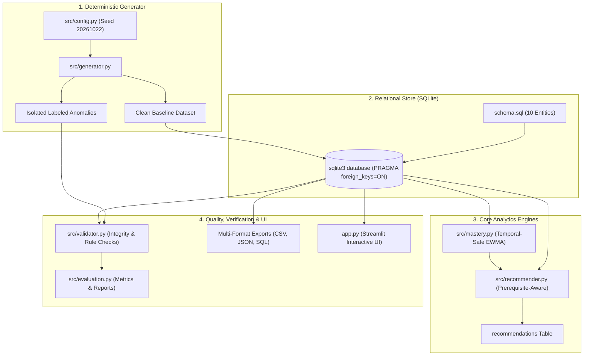
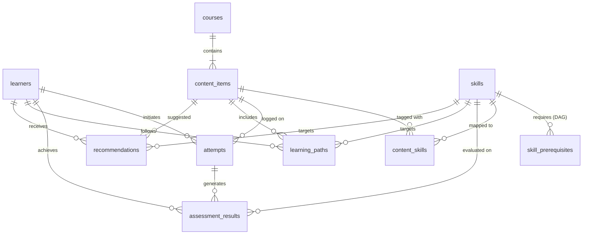

# System Architecture & Technical Specification

## 1. System Overview

The **YottaFlex Learning Recommendation Workflow** is a local-first, reproducible, explainable AI engineering pipeline designed for modern enterprise learning platforms. It generates deterministic synthetic learning telemetry at scale, tracks skill mastery without temporal leakage, gates educational progression via prerequisite DAGs, provides transparent multi-factor recommendations, and isolates intentional anomalies for data quality testing.

---

## 2. Component Breakdown

### 2.1 Configuration (`src/config.py`)
- Centralized constants, default seed (`20261022`), volume tiers (`small`, `medium`, `full`).
- Scoring weights ($w_{\text{gap}}=0.45, w_{\text{diff}}=0.35, w_{\text{rel}}=0.20$).
- Mastery thresholds (prerequisite minimum 0.70, mastery completion 0.85).
- Algorithm version identifier (`v1.2.0-explainable-heuristic`).

### 2.2 Data Access Layer (`src/data_access.py`)
- Thread-safe SQLite connection factory with automatic `PRAGMA foreign_keys = ON;`.
- DDL initialization from `schema.sql`.
- Optimized batch insertion (`executemany` with chunk sizes up to 10,000).
- Exporters for CSV (RFC 4180), JSON, and full SQL transaction dumps.

### 2.3 Synthetic Data Generator (`src/generator.py`)
- Seeded pseudo-random generation using Python's `random.Random(seed)`.
- Generates 10 entities in topological dependency order:
  1. `Courses`
  2. `Skills` (with levels 1-5 and domains)
  3. `SkillPrerequisites` (acyclic DAG ensuring $Level(P) < Level(S)$)
  4. `ContentItems` (associated with courses)
  5. `ContentSkills` (bridging content and skills)
  6. `Learners` (with registration dates)
  7. `Attempts` (ordered timestamps $start \le end \le now$, realistic scores)
  8. `AssessmentResults` (skill-specific evaluations per attempt)
  9. `LearningPaths` (sequenced content steps towards skills)
- Generates isolated anomaly test fixtures saved to `data/ground_truth/anomalies.json`.

### 2.4 Temporal-Safe Mastery Engine (`src/mastery.py`)
- Queries learner attempts with a strict as-of cutoff filter: `WHERE a.end_time <= ?`.
- Computes Exponentially Weighted Moving Average (EWMA) over chronological assessments:
  $$M_i = \alpha \cdot \text{Score}_i + (1 - \alpha) \cdot M_{i-1}, \quad \alpha = 0.35$$
- Guarantees future attempts cannot leak into past mastery or past recommendations.

### 2.5 Explainable Recommender Engine (`src/recommender.py`)
- **Step 1: Deficit Identification:** Identify skills where $Mastery(L, S, t) < 0.85$.
- **Step 2: Prerequisite Eligibility Gate:** Hard filter checking that all $P \in \text{Prerequisites}(S)$ have $Mastery(L, P, t) \ge 0.70$.
- **Step 3: Content Candidate Filtering:** Filter content items linked to eligible deficit skills that the learner has not already mastered/completed with a high score.
- **Step 4: Multi-Factor Scoring:**
  $$\text{Score}(L, C, S) = 0.45 \cdot (1 - \text{Mastery}) + 0.35 \cdot \left(1 - \frac{|\text{LearnerLevel} - \text{Diff}(C)|}{4}\right) + 0.20 \cdot \text{Rel}$$
- **Step 5: Explainability Output:** Attaches machine-readable reason code (`SKILL_DEFICIT`, `PREREQ_MET`, `DIFFICULTY_MATCH`) and a human-readable explanation string.

### 2.6 Data Validator & Anomaly Detector (`src/validator.py`)
- Primary-key uniqueness and foreign-key referential integrity checks.
- Timestamp ordering validation (`start_time <= end_time`).
- Format compliance for stable IDs.
- Graph validation:
  - Directed Acyclic Graph (DAG) cycle detection in `skill_prerequisites`.
  - Loop and dead-end detection in `learning_paths`.
- Evaluates labeled anomaly fixtures against expected rejection/flagging criteria.

### 2.7 Evaluation & Reporting (`src/evaluation.py`)
- Computes empirical metrics:
  - Referential integrity compliance rate (100% on baseline).
  - Anomaly detection Precision, Recall, and F1-score against ground-truth fixtures.
  - Recommendation coverage (% of active learners with valid next steps).
  - Prerequisite safety violation rate (0.0% expected on clean recommendations).
  - Runtime execution latency and dataset size.

---

## 3. Entity-Relationship Model

---

## 4. Anomaly Design and Isolation Strategy

To ensure zero baseline contamination while rigorously verifying edge-case detection, intentional anomalies are generated as isolated, cataloged fixtures:

| Case ID | Anomaly Name | Description | Injected State | Expected Handling |
|---|---|---|---|---|
| `ANOM-001` | Prerequisite Violation | Content recommended for skill whose prerequisite is unmastered ($<0.70$) | Recommender bypassed | Validator flags `PREREQUISITE_VIOLATION` |
| `ANOM-002` | Timestamp Inversion | Attempt recorded with $end\_time < start\_time$ | Timestamp inverted by 2 hours | Database constraint / Validator flags `INVALID_TIMESTAMP_ORDER` |
| `ANOM-003` | Orphaned Content-Skill | ContentItem mapped to nonexistent skill ID | `skill_id = 'SKL-999999'` | SQLite FK rejection / Validator flags `ORPHAN_CONTENT_SKILL` |
| `ANOM-004` | Temporal Future Leakage | Attempt completed at $t+7$ days influences mastery at $t$ | Evaluated at historical cutoff | Mastery engine rejects / Unit test verifies $M(t) \ne M(t+\Delta)$ |
| `ANOM-005` | Learning Path Loop | Path sequence contains repetitive cyclic steps without skill advancement | Cyclic content mapping | Validator flags `LOOP_WITHOUT_PROGRESS` |

All fixtures are stored in `data/ground_truth/anomalies.json` with ground-truth labels and tested in `tests/test_anomalies.py`.
